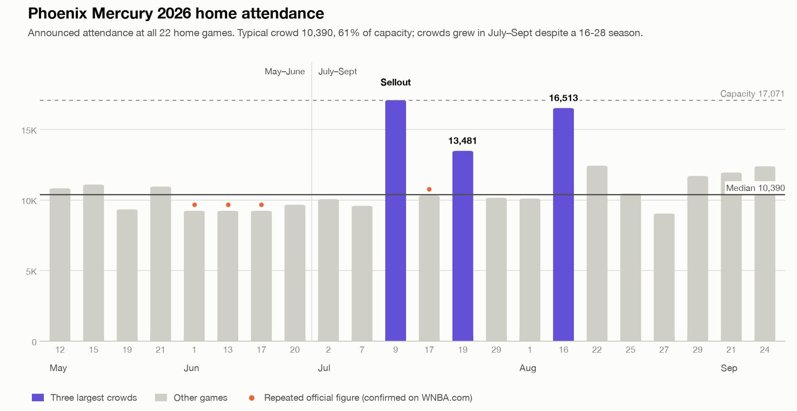

# Phoenix Mercury 2026 home attendance



**Question:** In a 16-28 season, what drew bigger crowds to Mercury home games?

**Short answer:** The calendar did more than the team's results. Crowds grew as the season went on, and Fri-Sun games drew more than weeknights. Opponent quality barely mattered.

Interactive version: https://raghav-aggarwal-20.github.io/mercury-2026-attendance/

## Findings

1. **Crowds grew while results did not.** The May-June median was 9,500 over 8 games (2 wins). The July-September median was 11,079 over 14 games (5 wins), about 17% higher. The share of Fri-Sun games was similar in both halves (3 of 8 and 6 of 14), so the schedule doesn't explain the jump.
2. **Weekends helped.** Fri-Sun games had a median of 11,094. Mon-Thu games had 10,152, about 9% lower.
3. **A typical night was about 61% full.** The median home crowd was 10,390, or 60.9% of the 17,071 basketball capacity. The average was 11,128, because three games (Indiana on July 9, Portland on August 16, Connecticut on July 19) pulled it up. I use medians throughout for that reason.
4. **Opponent standings had little effect.** The median against 2026 playoff teams was 10,459. Against non-playoff teams it was 10,321.
5. **Wins look like a draw, but mostly because of timing.** Wins had a median of 11,094 and losses 10,321. But 5 of the 7 home wins came in July-September, when crowds were bigger anyway.
6. **Star power is harder to read.** August 16 vs Portland, the first home game after Kelsey Plum's Phoenix debut, drew 16,513 even though she sat out injured. Her only home appearance, August 25 vs Washington, drew 10,459. August 16 was also a Sunday, so the day and the timing of ticket purchases may explain more than who played.

These are descriptive comparisons across 22 games. With samples this small, a single big night can move a split, so I treat them as patterns to check against ticketing data, not as proven effects.

## Data quality

The league reported 9,234 for three June home games (June 1, 13 and 17). The July 17 figure (10,321) matches the Mercury's road crowd in Las Vegas on July 11. I checked all four against the WNBA.com box scores and they match. A scan count is unlikely to repeat exactly, so I treat these as reported figures and lean on medians and the July-September games for the trend. The four rows are flagged in the data and marked on both charts.

## Data

`data/mercury_2026_home_games.csv` has one row per home game. Attendance, opponent, result and record come from the game log on the [2026 Phoenix Mercury season](https://en.wikipedia.org/wiki/2026_Phoenix_Mercury_season) Wikipedia page. I added weekday, Fri-Sun vs Mon-Thu, opponent playoff status from final standings, percent of capacity, and the data-quality flag.

Attendance is the announced figure. It does not separate paid, distributed and scanned tickets.

## Run it

```
pip install -r requirements.txt
python src/analyze.py
```

The script loads the CSV into SQLite with `sql/schema.sql`, runs the queries in `sql/analysis.sql` (totals, repeated figures, splits), and writes medians to `output/median_summary.csv`. Medians are computed in pandas because SQLite has no median function. It also draws the chart above to `output/attendance_by_game.png` and builds the interactive version from `src/dashboard_template.html` into `docs/index.html`, which GitHub Pages serves.

## What would come next with internal data

- Paid vs. distributed vs. scanned tickets per game, to tell real demand from comps and confirm the repeated figures
- Season ticket member share of each crowd, to see whether the second-half growth came from single-game buyers
- Average price paid and promotion-night flags, to separate demand from discounting
- Secondary-market resale volume per game, as a demand signal for the big nights
